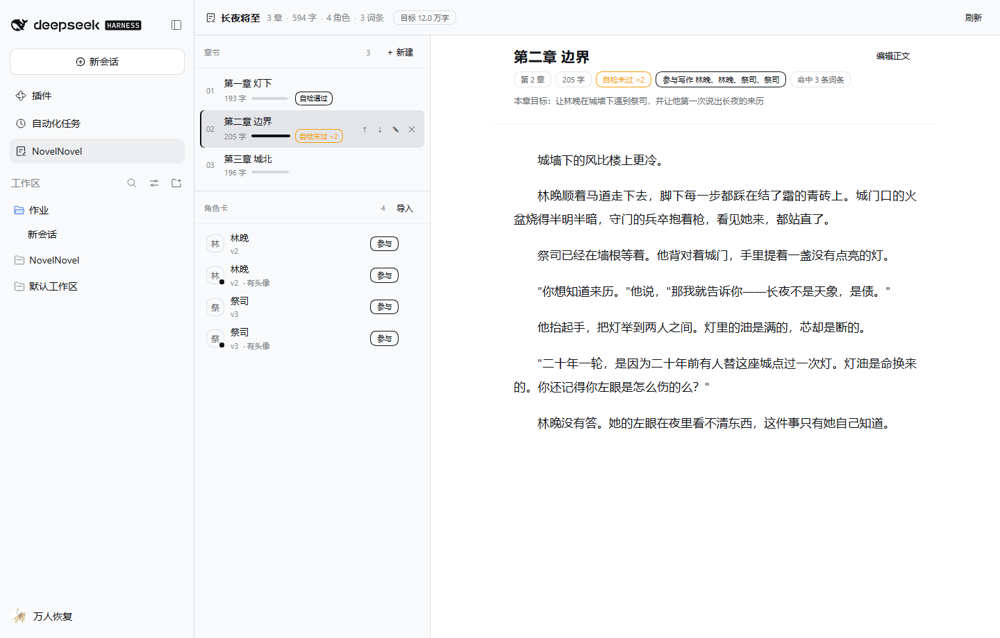
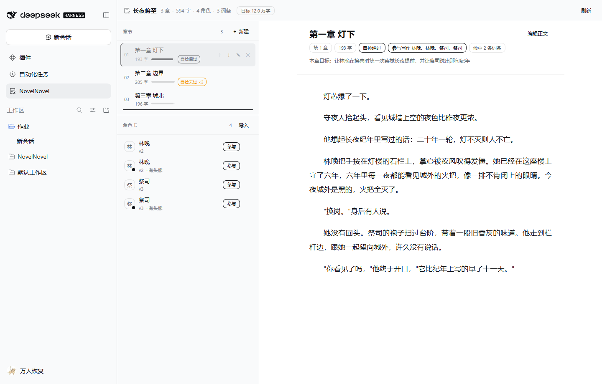
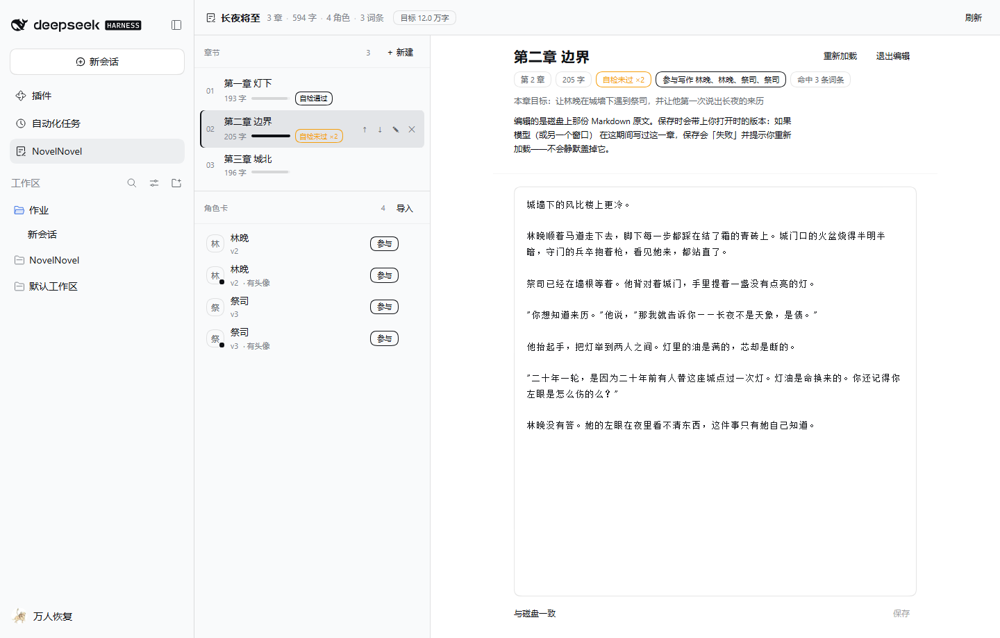

# dsh-novelnovel · DeepSeek Harness 插件

用工作区里的**普通文件**写小说：agent 直接用 `novel_*` 工具建作品、写正文、导角色卡、维护世界观词条、
检索与导出，**续写由 harness 的模型承担**，插件负责把作者的设定（世界观 / 命中词条 / 参与角色 /
写作预设 / 前文摘录）组装成写作简报交给它；方法层面的东西（文风、对话、节奏、结构）由自带的技能承载，
也可以导入你自己的。另外带一个**侧栏面板**：读起来像一本书，也能在面板上改章节正文、导入角色卡、设目标字数。

本仓库就是插件包（`dsh.bundle.patch` → `cordis.patch.yml`，向 profile 插入一行 `id: novelnovel`）。
领域逻辑（角色卡解析、预设解析、技能包解析、提示词组装、词条关键词匹配、章节排序、全文搜索、
PNG 卡读写、字数统计）集中在 `src/domain/`，与 harness 侧的存储/注册代码分离。

## 界面

侧栏图标打开的面板（截图里是演示数据：3 章 / 4 张卡 / 3 条词条）：



左栏是章节（字数、体量条、自检标记）与角色卡（参与开关直接点），右栏是正文；顶部一行给出这本书的
规模与目标字数，章节下方一行是**本章目标**与「本章注入了哪些词条」。

**章节拖拽排序**——拖到任意位置，落点画一条线；`↑↓` 按钮保留给键盘与触屏。



**正文编辑**——直接改磁盘上的 Markdown 原文。保存会带上「你打开时的那一版」，如果模型（或另一个窗口）
在这期间写过这一章，保存会**明确失败**并让你重新加载，而不是静默覆盖。



## 安装

前置：`dsh` CLI 与 `pnpm` 都在 PATH 上——`dsh plugin` 是把参数转发给 profile 目录里的 pnpm。
**桌面端安装里两者都不在 PATH 上**，用应用自带的 wrapper：`<安装目录>\resources\runtime\cli\bin\dsh.cmd`
（它内部已经把 pnpm 指向 `resources/runtime/pnpm/bin/pnpm.mjs`）。下面统一写成 `$DSH`。

### 推荐：先建一个专用 profile（`nn`），别装进日常界面

客户端半边是 **fail-closed** 的：一个包声明了 `dsh.client` 而产物读不到，宿主启动时会**同步抛错**，
结果是**所有**客户端插件（含首方 UI）一起加载不出来。开发迭代期把面板装进日常用的 profile，
一次构建失误就能让你连界面都打不开。所以：

```powershell
$DSH = "<安装目录>\resources\runtime\cli\bin\dsh.cmd"
& $DSH --profile nn --from-default-profile web --dump-config   # 建 profile，只打印组合树、不起服务
& $DSH plugin --profile nn add D:\NovelNovel                   # 装插件（只装进 nn）
& $DSH --profile nn                                            # 起界面，终端打印带 token 的 URL
```

**`--from-default-profile web` 这一步不能省。** 自带模板只认 `web` / `headless` / `acp` / `sdk` /
`sdk-minimal` 这五个**名字**，别的名字不会被自动初始化；而 `dsh plugin --profile nn add` 对没有模板的
名字只给 `@deepseek-ai/dsh-base`——**base 只是内核，没有 Host、没有 HTTP、没有 runner**，装上也看不到界面。
`--from-default-profile web` 让新名字从 `web` 模板的**组合包列表**起步（只复制包清单，
不复制那个 profile 的任何本地状态）。加 `--dump-config` 是为了「只创建、不起服务」。

### 装来用（tarball，不依赖工作树）

```bash
git clone https://github.com/wanrenhuifu/NovelNovel.git && cd NovelNovel
npm install
npm pack                                  # prepack 会自动构建出 lib/（宿主 + 客户端两个产物）
dsh plugin --profile web add ./dsh-novelnovel-0.1.0.tgz
dsh web
```

### 装来改（源码 link）

```bash
npm install
npm run build
dsh plugin --profile web add .            # 装成 link，指向这个工作树
```

改完 `src/` 之后要 `npm run build` 再**重开 dsh 会话**——profile 加载的是构建产物，不是源码。
`link:` 装法下重建产物即生效，所以**装了插件的 profile 会被工作树直接影响**：
这也正是"开发迭代别装日常 profile"的另一半理由。

### 装进 DSH 桌面端

桌面端有自己的 profile，叫 `desktop`，由应用独占（`dsh --profile desktop` 启动会被拒），
但**插件管理是支持的**——桌面端自带的 CLI wrapper 就是以「允许管理 desktop」的方式跑起来的。
步骤：

```powershell
# 1) 完全退出 DeepSeek Harness Desktop（它持有 profile 的 package.json 锁）
# 2) 用桌面端自带的 CLI 装（路径按你的安装位置改）
& $DSH plugin --profile desktop add D:\NovelNovel
# 3) 确认这条依赖进了清单，并且**同时**进了 dsh.profile.bundles
[System.IO.File]::ReadAllText("$env:USERPROFILE\.dsh\profiles\desktop\package.json")
# 4) 重开桌面端 —— 这一步不能省，理由见下
```

> 读 profile 的 `package.json` 请走 .NET（`[System.IO.File]::ReadAllText`）：
> Windows PowerShell 5.1 的 `Get-Content` 会按 ANSI 解码无 BOM 的 UTF-8，中文变乱码。

**第 4 步为什么不能省**：插件只在**启动时**装载，装进 profile 之后不重开就不会生效。

> **加载只看 `dsh.profile.bundles`**：清单里 `dependencies` 有、`dsh.profile.bundles` 里没有 = **不加载**
> （app-boot 的 `loadProfileDirectory` 逐个解析这个列表）。用手动改清单装插件时最容易漏这一项。
> 反过来，在侧栏「插件」页**主动取消选择**某个组合包，产出的就是这个状态——那时是有意的，不是故障。
>
> 装完怎么确认生效：让模型调一次 `novel_project action=list` 或 `/novel`。命令返回当前作品状态，
> 不经过模型，是最快的判据。

`desktop` profile 是 `patchReload: live`，但改 `src/` 后仍然要 `npm run build` + 重开会话
（profile 加载的是 `lib/` 产物，不是源码）。

⚠️ **桌面端的工作区根 = 那次会话选定的目录**。打开桌面端后在**你的小说目录**里开会话，
数据才会落在那里（`.novelnovel/`）；在别的目录开会话，`novel_project action=list` 会是空的。

### npm

还没发布到 npm。发布之后会是 `dsh plugin --profile web add dsh-novelnovel`，装的是预构建产物，
不需要任何构建授权。

### 装进哪个 profile

| profile | 用途 |
|---|---|
| `web` | 浏览器界面，交互式写作 |
| `headless` | 一次性任务：`dsh --profile headless "给《长夜将至》写第三章"` |
| `desktop` | DSH 桌面端（应用独占，只能按上面那节的方式装插件） |
| `nn` / 任何自定名 | **开发迭代用**：从 `web` 模板起步，与日常界面隔离 |

⚠️ 只有 `web` / `headless` / `sdk` / `sdk-minimal` / `acp` 这五个名字会从自带模板自动初始化。
**自己起别的名字只会得到 `dsh-base` 一个 bundle，而 base 只是内核**——没有 Host、没有 HTTP、
没有一次性 runner，装上也用不了。自定名要走 `--from-default-profile web`（见上面的推荐一节）。
`desktop` 不在其中：它由桌面端应用初始化，`dsh` 启动器会拒绝
`dsh --profile desktop`（但允许 `dsh plugin --profile desktop`，见上一节）。

### 验证装上了

```bash
# 浏览器端 / 一次性任务 / 自定 profile
$DSH --profile nn --dump-config | Select-String novelnovel    # 应能看到 # == dsh-novelnovel 那一层
# 桌面端（要用自带 CLI）
& $DSH --profile desktop --dump-config | Select-String novelnovel
```

装完**必须重开**才算生效：客户端插件的注册表只在**应用启动/插件层变动**时构建一次，
之后是增量扫描。所以"装完不重开"的表现是：**宿主半边（`novel_*` 工具）正常工作、
侧栏里却没有面板、浏览器 console 也没有报错**——很难归因（实测踩过一次：
应用启动于 16:49、插件 17:12 装进 profile，注册表里根本没有这个包，直到重开才出现）。

> **面板没出现怎么办**：先确认已经**完全退出并重开**过。若仍没有，打开 DevTools（F12）
> 看 console 有没有 `ClientPackageCompositionError` / `MissingClientBundleError` /
> `missed the module table` / `slot entry crashed` 之一，按那个关键词排查。
> 宿主半边是否正常可以这样快速判断：随便让模型调一次 `novel_project action=list`。

> **面板显示"尚未确定工作目录"**：这是设计如此，不是故障。HTTP 路由**没有会话上下文**，
> 工作目录只能由面板告知，而面板只认「本进程里真会话用过的工作目录」（否则等于把任意目录读取
> 开放出去）。所以先在本会话里让模型调用一次任意 `novel_*` 工具（或用 `/novel`），再点面板的刷新。

### 不支持从 git 直接安装

`dsh plugin add github:wanrenhuifu/NovelNovel` 装不起来：git 安装拉的是源码而不是构建产物，
本包没有 `prepare` 脚本，到手没有 `lib/`，加载会失败。请用上面的 tarball 路径。

### 从哪个目录启动

dsh 把**启动时所在的目录**当作工作区根：小说数据落在 `<那个目录>/.novelnovel/`，项目级技能落在
「最近的含 `.git` 的祖先目录」的 `.dsh/skills/`。所以先 `cd` 到你的小说目录再启动（桌面端则是
在小说目录里开会话）。

## 兼容性

**当前结论：适配 DSH 桌面端 `@deepseek-ai/dsh@0.2.1-rc.2`（DSH Desktop，Node 24.21 / Electron 44.7）。**
上一版验的是 `0.2.0-rc.2`（Node 24.18.1），升级后重跑过全量闸门。核查方式（都可复跑）：

- 清单版本门槛用运行中的真品判定：`@deepseek-ai/dsh-app-boot` 的 `evaluatePluginCompatibility`
  跑本包 manifest + 运行时版本 → 无冲突项（不兼容会在安装期就被拒，不会等到运行期）。
- `src/contract.ts` 镜像的 API 面逐项对照：`ToolDefinition`/`defineTool`（仍支持
  author-only 的 `type:"json"` 与 `isConcurrencySafe`）、`ToolRunContext.agent.session.header.cwd`、
  `ctx.fs` 的读写与 `writeText` 五参签名、`fs/observed` 事件签名、`ctx.skills.register` 的
  runtime rank 250、`ctx.commands`、`ctx.systemPrompt` —— 均无签名差异。
- “先读后写”策略的归属判定也没变：`dsh-fs-observation-policy` 仍然从 `actor.agent.session`
  推导 owner，所以插件写入照旧记在调用方会话名下。
- 客户端半边：`npm run test:primitives` 会**从安装里的前端产物把外壳的静态模块表挖出来**，
  核对我们的 `require` 说明符都在表里（0.2.1 起 `dsh-client-ui-primitives` / `-ui-slots`
  **不再是独立 npm 包**，被打进了 `dsh-web-frontend` 的 bundle，但模块表里两个键都还在）。
- 端到端：`npm run test:dsh` 67 项全过（其中一组走 `ctx.tools.execute` 真分发，参数与输出
  schema 都由 harness 校验）；真浏览器里也看过面板（见上面「侧栏面板」一节）。

历史记录（保留，但已不是当前结论）：`0.2.0-rc.2`、`0.1.5-rc.1`（npm `latest`，子包 `0.1.5-rc.2`）、
`0.1.2-rc.1` CLI + `0.1.3-alpha.2` 子包都验证过。

`package.json` 的 peerDependencies 用通配 `*`：插件运行时由 `src/harness.ts` 解析 harness 自己的包实例
（保证与运行中的 harness 同模块实例），不在依赖层面锁版本。`src/contract.ts` 是逐项比对后的手写副本——
上游改了签名要靠重新比对发现，所以升级 harness 后**重跑一次 `npm run test:dsh` 与 `npm run test:guard`**。

这一点与生态里多数插件的做法不同（它们写 `>=` 或 caret 区间，代价是 harness 一升级就可能装不上），
是本仓库有意的取舍：harness 还处在 developer preview，锁区间只会把上游的破坏性变更变成安装期的报错，
而真正的兼容性由 `contract.ts` 的逐项比对和端到端验证保证。

⚠️ **工作树里不要留 `@deepseek-ai/*` 的副本**（`node_modules/@deepseek-ai/` 里的旧版本就是这种情况）：
解析链一旦命中它，插件就会加载**第二份 harness**——服务按模块实例注册，双份会重复注册。
`src/harness.ts` 现在会校验解析结果的版本是否与运行中的 harness 一致，不一致就报错拒绝，
并告诉你修法；`npm run test:guard` 就是这条行为的用例。

## 用法

在装了插件的 profile 里开一个会话，直接用自然语言提写作需求即可；系统提示词会引导 agent 使用这些工具：
| 工具 | 作用 |
|---|---|
| `novel_project` | 作品的新建 / 列表 / 详情 / 改设定（简介、世界观、写作要求、**全书梗概 `outline`**、**全书目标字数 `target_words`**）/ 切换当前作品 / 删除 |
| `novel_chapter` | 章节列表（`from`/`limit` 分页、`verbose=false` 精简）、读取、新建（可带 `goal`）、**追加（写正文的入口）**、覆写、改名、打标签、**写本章目标与摘要（`meta`）**、排序、检索、删除 |
| `novel_character` | SillyTavern 角色卡（PNG/JSON，V1/V2/V3）导入、查看、参与开关、再导出 PNG、移除 |
| `novel_source` | **资料源**（现代社区卡 / 独立世界书）导入与查看：导入时**拆解 + 按通道分类**（设定 / 文风 / 玩法规则 / 状态初值 / 角色档案 / 素材），可注入的并入世界书并记来源，状态与素材只读保留；列表、详情、启用/停用 |
| `novel_lorebook` | 世界观词条维护（带关键词=命中才注入，无关键词或 `constant`=常驻注入） |
| `novel_preset` | 写作预设导入（SillyTavern JSON）/ 手写 / 编辑 / 激活 / 停用 |
| `novel_skill` | 项目级写作方法技能：列出 / 导入技能包（JSON）/ 导出分享 / 删除 |
| `novel_context` | **写作前必调**：组装本次的写作简报（系统提示词 + 指令块 + 注入清单 + 参与角色 + 写作进度） |
| `novel_review` | **写完必调**：一章的判定闸——本地硬门槛（字数/格式/与前章重复）+ 只读子 agent 的语义自检（推进 goal 了吗、与大纲/设定/前文矛盾吗），返回 `pass` / `fail` / `inconclusive` 与具体改法 |
| `novel_export` | 整书导出 Markdown / TXT，或全量备份 JSON |

另外自带 8 个技能，agent 按需加载（`/novel-plan` / `/novel-prose` 之类的手势也能直接触发）：

| 技能 | 管什么 |
|---|---|
| `novel-plan` | **入口**：先规划后正文。产出三层大纲（全书梗概 / `outline.md` 细纲 / 每章目标），**产出后停下来给人确认** |
| `novel-quick` | **入口**：跳过大纲直接进入写作循环；适合短篇与没有贯穿性线索（单元剧/日常）的作品 |
| `novel-writing` | 工具流程与连续性检查（先读简报、写正文、落盘、记设定） |
| `novel-cards` | 角色卡 / 预设的导入语义与宏规则 |
| `novel-prose` | 文风与叙述：视角一致性、叙事距离、句式节奏、去 AI 味 |
| `novel-dialogue` | 对话：潜台词、说话人辨识度、标签与动作拍、避免翻译腔 |
| `novel-scene` | 场景与节奏：场景 vs 概述、目标/阻碍/转折、章末钩子 |
| `novel-outline` | 结构与大纲、伏笔回收、通读一致性审计、中文网文套路 |

技能是**按需加载**的：模型平时只看得到每个技能的名字和一句描述，判断相关了才把正文拉进上下文。
所以这些方法平时不占上下文，也不会和你的写作预设打架——需要的时候它们才出现。

### 两个入口技能：`/novel-plan` 与 `/novel-quick`

它们是**技能而不是斜杠命令**，这是有意的：命令处理器不经过模型、只能返回文本，而这两个入口要让
**模型**去做事（建作品、产大纲、写正文）。技能用 `/名称` 触发时注入的是指令，模型随即行动。
（反差：`/novel` 是命令，它只打印当前作品状态，不经过模型。）

- `/novel-plan` —— 两阶段的第一阶段：产出三层大纲（`project.outline` 全书梗概——**这一层每章自动进简报**、
  项目目录里的 `outline.md` 细纲——太长不注入、每章的 `ChapterMeta.goal`——进简报的指令块），
  **然后停下来给人看**。理由很直接：改大纲只要一条消息，
  改已经写好的章节要重写它牵动的每一章（以及简报已经让模型保持一致的那些设定）。
- `/novel-quick` —— 跳过规划，直接进写作循环。判据不是长短而是"这本书有没有需要收束的伏笔/主线/关系弧"；
  没有就适合走这条，短篇也走这条。

两条路径共用同一个写作循环：`novel_context chapter=<ref>` 取简报 → 写正文 →
`novel_review` 自检（没过就改，改完再自检）→ `novel_chapter action=append` 落盘 →
用 `novel_lorebook action=add` 记新设定。

### 自检闸：`novel_review`

自动写作最容易出的问题不是"写不出来"，是"写出来了但这一章是废的"（没推进目标、跟上文矛盾、
跟上一章重复）。所以落盘前后各有一道闸，分两层，谁便宜谁先跑：

1. **本地硬门槛**（毫秒级、零 token）：字数下限（默认不设）、正文里混进的 Markdown 标题 /
   代码围栏 / `字数：1234` 这类元话语、与**上一章尾部**连续重合超过 20 字的片段。
   不过就直接判不合格，**不会**去起子 agent。
2. **只读子 agent 的语义判定**：把本章正文 + 本章目标 + 全书大纲 + 上一章尾部 + 命中词条
   交给一个一次性子 agent，让它答"推进了目标吗 / 与前文矛盾吗 / 是不是半成品"。
   它**只判定、只给建议**：没有改写正文的权限，也没有任何工具（技能都加载不了）。

返回三种结论，第三种是关键：

| 结论 | 含义 | 该怎么办 |
|---|---|---|
| `pass` | 两层都过了 | 保留这一章，写下一章 |
| `fail` | 有问题，附具体改法 | 按清单改，改完再 `novel_review` |
| `inconclusive` | 本地过了，但**语义没判成**（这个组合没有 subagent 服务 / 子 agent 报错 / 返回坏形状） | **这不是通过**：自己判连续性与任务契合度再决定 |

几条刻意如此的口径：

- **先审草稿再落盘是首选**：`novel_review chapter=3 text="<草稿>"` 在正文还没写进文件时就能判，
  过了再 `action=append`。这样永远不会覆盖已经落盘的正文。
- **同一章连续判不合格的计数会落盘**（`chapters/index.json` 每章的 `review` 字段）。
  到上限（默认 3 次）报告里会出现 `STOP`：不再建议重写，而是把问题交给作者决定。
  **基础服务故障不计入、也不清零**这个计数——它不是"这一章写坏了"。
- **只有 `pass` 会把摘要写进章节**：判不合格的正文马上要重写，此时落一份摘要是给未来留假信息。
- **自检不会自己写词条**：子 agent 提的新设定只是**建议**，由前台模型决定要不要
  `novel_lorebook action=add`（写权留在前台）。
- `local_only=true` 只跑第一层，用来在草稿阶段白嫖一次长度/格式/重复检查。

### 让它自己写完一整本

`novel_context` 与 `novel_project action=show` 都会报一行进度
（`progress: 12/24 chapters have text · next unwritten: 第十三章 [xxx] — goal: …`），
所以"还剩几章、下一章是谁"不用模型自己数。整本书的循环靠 harness 的 goal 自动续轮驱动：

```text
（用户在某一轮里说"把这本书写完"）
create_goal objective="写完《长夜将至》全部 24 章，每章都要过 novel_review"
→ 之后每一轮写一章：novel_context → 写 → novel_review → action=append → 记设定 → 下一章
```

`create_goal` 只在**真人开口的那一轮**可用（harness 的硬闸），所以技能会要求在收到请求的那一轮
就把目标打上，而不是等到后面。

## 侧栏面板（读 + 写）

Web 界面（`web` / `desktop` / 任何带 Web 面的 profile）的侧栏会多一个 NovelNovel 图标，
点开是当前作品的**章节列表 + 正文**，按读一本书的样子排版：行宽行距按中文小说调过，
章节行带体量条（按最长章节归一化，不写死"多少字算长"），正文区显示参与写作的角色、命中的词条数
与每章的**自检结论**（通过 / 未过 ×N / 未判定）。

**能改的都在这里**（早期版本只读，现在写操作都补齐了）：

| 位置 | 能做什么 |
|---|---|
| 章节列表 | 新建 / 改名 / 上移下移 / 删除（要二次确认） |
| 正文区 | 「编辑正文」→ 直接改 Markdown 原文 → 保存；草稿未保存时会提示 |
| 角色卡（左栏下半） | 导入本机的 PNG / JSON 卡（≤ 8 MB）、勾选「参与写作」、删除（二次确认） |
| 顶栏 | 设置**全书目标字数**，显示「已写 / 目标（百分比）」 |

### 与模型抢同一份稿子时会发生什么

面板写的是工作区里**同一份** `.novelnovel/` 文件，模型也在写它。所以每条写入都带版本校验：

- 保存正文时，面板把它**打开时读到的那份文本**一起回传。宿主比对磁盘：对得上才写，
  对不上就回 **409**，面板显示「这一章在你编辑期间被改过了……**没有保存**」。
  这时点「重新加载」拿到最新正文，再在最新的一版上重做改动——**不会静默盖掉任何人的字**。
- 冲突时**你的草稿不会被清掉**（留在编辑器里），刷新只影响底稿。
- 反过来，模型那边的写入也走同一套：它在面板改过文件之后写，会失败并提示重新读取。

### 安全口径（能写之后才需要说的）

- 路由仍然只认**本进程里真会话用过的工作目录**（`?cwd=` 由面板告知并按白名单校验），
  未注册的工作区一律 **403 `unknown_workspace`**。
- **写请求另加一道同源校验**：`Sec-Fetch-Site: cross-site`，或 `Origin` 指向别的站点，
  一律 **403 `cross_origin`**。读请求不需要（跨源读会被浏览器的 CORS 挡住）。
- 删除类操作要求 `confirm=true`，面板上的「确认删除」就是它的来源。
- 面板写入会**记进「先读后写」的台账**（复用白名单里那个真会话对象作为 actor），
  所以模型之后可以直接写它、不需要先读一遍——没有"面板是例外"这种口径。

### 三条容易误判成故障的行为

- **首次打开显示"尚未确定工作目录"**：HTTP 路由没有会话上下文，工作目录只能由面板告知，
  而面板只认「本进程里真会话用过的工作目录」。先让模型调一次任意 `novel_*` 工具，再点刷新。
  （这条白名单不是多余的小心：没有它，任何拿到会话 cookie 的页面都能指定任意目录去读写。）
- **点保存没反应/报 409**：多半是模型正在同一章上工作。按提示「重新加载」再来，别把草稿弄丢。
- **读不出来的东西一律点名**：作品目录坏了、某章正文文件不在磁盘上，面板会**明说**（而不是显示成空），
  否则用户会以为"没有作品"而去新建，真正的问题是他手改坏了一个文件。

### 还没做（面板侧）

- **项目设定**（简介 / 世界观 / 写作要求 / 大纲 / 标题）还不能在面板上改——目前只有目标字数有入口，
  其余仍然由模型用 `novel_project action=update` 写。
- **角色卡头像**只显示"有/没有"，面板不渲染图片。
- **词条（lorebook）面板**还没有，`novel_lorebook` 只有工具面。
- 面板不做**自动刷新**：模型写完不会自己跳出来，点「刷新」或重开面板（`connection/reset` 会重取）。

## 装你自己的写作方法

项目根的 `.dsh/skills/` 是 harness 自己的技能目录：它会被自动扫描、改动实时生效，而且**优先级高于
插件内置技能**（项目 rank 100/200，插件 rank 250）——所以同名时生效的是你那一份。

你可以直接往里放 `SKILL.md`，也可以让 agent 用 `novel_skill` 导入一个技能包：

```jsonc
// 技能包：可以含多个技能；也可以去掉 skills，把单个技能写在顶层
{
  "name": "我的爽文写法",        // 包名，给人看的，可含中文
  "author": "you",
  "version": "1.0.0",
  "skills": [
    {
      "name": "fast-payoff",    // 必须是 kebab-case，其它形式 harness 会拒绝
      "description": "Move the payoff closer to the setup.",  // 模型唯一能看到的字段，写成路由判据
      "whenToUse": "爽点 / 铺垫太长 / 节奏太慢",                // 可选，补充触发场景（中文触发词要留在这里）
      "content": "# 爽点前移\n\n正文，Markdown。"              // 技能正文
    }
  ]
}
```

```text
novel_skill action=import path=my-pack.json          落到 .dsh/skills/，harness 实时收录
novel_skill action=list                              现在装了哪些、哪些覆盖了内置技能
novel_skill action=export name=fast-payoff           导出成包，可以分享给别人
novel_skill action=remove name=fast-payoff confirm=true
```

导入的技能和你手写的技能走**完全相同的加载路径**——插件只负责摆文件，加载是 harness 自己的事，
所以插件里没有第二套技能机制。`novel_skill` 也只删自己导入的（按 `.novelnovel-skill.json` 标记识别），
手写的技能它一律不覆盖、不删除。

需要知道的一件事：harness 取的项目根是「最近的含 `.git` 的祖先目录，没有就用当前工作目录」。如果会话
开在仓库的子目录里，技能该放的地方就在工作区之外了——这时 `novel_skill` 会**拒绝并说明原因**，
而不是写到一个不会被扫描的位置。

斜杠命令 `/novel`：直接打印当前作品状态（`/novel list` 列出全部，`/novel <作品>` 切换当前作品），
不经过模型。

> **它要按两次回车**：因为它带参数（`list` / 作品名），Web 端第一次回车是"认领这个命令、等你给参数"
> ——输入框会变成 `/novel ` 并显示参数提示，**再按一次回车才真的执行**。也可以 `/novel` 后打一个空格
> 再回车。不带参数的命令（如 `/compact`）才是一次回车就跑。

一小段系统提示词（order 4500），说明这个工作区里的小说该怎么写。

典型流程（agent 视角）：

```text
novel_context chapter=3 instruction="写林晚在城墙下遇到祭司"   → 拿到简报
（按简报写正文）
novel_chapter action=append chapter=3 text="…"                → 落到章节
novel_chapter action=meta chapter=3 goal="推进祭司线"          → 记下这一章要推进什么（可选）
novel_lorebook action=add name=祭司 keys=夜祷 content=…        → 记录新设定
```

要写整本书就走两个入口技能之一：`/novel-plan`（先产三层大纲、停下等你确认）或 `/novel-quick`
（直接进上面的循环）。两者都只是**指令**，真正的动作由模型执行。

`novel_context` 返回的系统提示词区块是设定与文风的权威来源：它就是给模型的 system prompt，
由 harness 自己的模型来遵守。

## 配置

在 profile 的 `cordis.patch.yml` 里按行 id 覆盖，无需改插件包：

```yaml
- id: novelnovel
  name: dsh-novelnovel
  config:
    dataDir: .novelnovel          # 数据根目录（相对工作目录，默认 .novelnovel）
    defaultPrevChapterCount: 2    # 简报默认携带的前文章节数（默认 1）
    defaultPrevChapterChars: 2000 # 每个前文章节摘取的尾部字数（默认 1500）
    defaultRecentChars: 4000      # 当前章摘取的尾部字数（默认 3000）
    maxPrevChapterCount: 5        # 模型单次能要的前文章节数上限（默认 10，硬上限 20）
    maxPrevChapterChars: 8000     # 单章能摘取的字数上限（默认 20000）
    minChapterChars: 800          # novel_review 的字数下限（默认 0 = 不设）
    maxRepeatRunChars: 20         # 与上一章重合多少字算重复（默认 20，0 = 不查）
    reviewFormatChecks: true      # 是否检查正文里的标题/元话语（默认 true）
    maxReviewAttempts: 3          # 同一章连败几次就停下来交给作者（默认 3，0 = 不设上限）
    maxInjectedLoreEntries: 24    # 命中词条的注入条数上限（默认 24，0 = 不限；常驻条目不受它约束）
    maxInjectedLoreChars: 24000   # 命中词条的注入字符预算（默认 24000，0 = 不限；常驻条目不受它约束）
    reviewProvider: deepseek      # 自检子 agent 的模型路由（默认继承当前会话）
    reviewModel: deepseek-chat
```

非法配置（绝对路径、`..`、负数、超过硬上限、布尔/字符串写错）在加载期直接抛错，不静默取默认值。
`maxPrevChapterChars` / `maxPrevChapterCount` 是**上下文预算的闸门**：不设上限时模型可以要求把
整本书读进简报。`maxInjectedLoreEntries` / `maxInjectedLoreChars` 是词条侧的同类闸门（见下）。

### 词条注入的闸门

`novel_lorebook` 的规则是"关键词命中就注入"。一本书 200 条词条时，某一章同时提到城墙、祭司、
夜祷，可能一次命中 30 条——全文进提示词，真正相关的那几条被淹掉。所以命中条目要过两道闸，
**默认那一道永远是本地算的**（毫秒级、零 token、结果稳定）：

1. **相关度排序 + 双上限**：按"命中几个关键词"降序（同分按 id 稳定排序，所以简报可复现），
   逐条注入直到**条数上限或字符预算先到**为止。被砍掉的条目会在简报里**点名**
   （`(left out by the injection limits: …)`），需要时模型自己去读 `lorebook.json`。
   **无关键词的常驻条目不受限**——那是作者显式要求每回合都带的。
   单条词条就超预算时也至少放它一条：清空全部设定比多花几百 token 更糟。
2. **可选：只读子 agent 的语义筛选**（`novel_context filter=true`）。关键词召回是机械的
   （命中 3 个词的不一定比命中 1 个的更相关），所以要更准时可以多花一次子 agent 往返。
   它的权限是**只准删不准加**：返回的是"这些候选里哪些不要"，候选池之外的 id 一律忽略并点名。
   **筛选失败就退回本地召回的结果**（漏注入丢设定，比多注入严重得多），默认不开启。

## 数据布局

```text
<工作目录>/.novelnovel/
  workspace.json                        当前作品
  projects/<projectId>/
    project.json                        标题 / 简介 / 世界观 / 写作要求（+ 可选：全书梗概 `outline` 每章进简报、目标字数 `targetWords` 只看进度）
    outline.md                          可选：细纲（分卷/分幕、伏笔、关系变化）。**不进简报**，模型按需 `read`
    lorebook.json                       世界观词条
    presets.json                        写作预设与激活项
    chapters/index.json                 章节元数据（标题、标签、顺序；+ 可选的 `goal` / `summary` / `review`）
    chapters/<chapterId>.md             章节正文（Markdown，可直接用 read/write 工具编辑）
    characters/<id>.json               角色卡（rawData 无损保留）
    characters/<id>.<ext>              原始头像（扩展名与真实媒体类型一致）
    exports/                            导出结果
  skillpacks/                           novel_skill 导出的技能包

<项目根>/.dsh/skills/                   项目级技能（harness 自己扫描，含 novel_skill 导入的）
  <技能名>/SKILL.md
  <技能名>/.novelnovel-skill.json       导入标记（手写的技能没有它）
```

正文独立成文件是有意的：长篇小说用 `read`/`write` 工具直接改正文比走工具更顺手，
而 `novel_chapter action=list` 会重新读文件统计字数，所以绕过插件直接改文件也不会失同步。
（`novel_project action=list` / `action=show` 里的**总字数**走的是按文件大小校验的缓存——
只在直接改文件时省一次重读，改过就重算，所以你改完文件再列作品看到的仍然是真实字数。）

技能不放在数据目录里，因为它是整个工作区的写作方法，不属于某部作品——见「装你自己的写作方法」。

### 大纲字段（三层，全部可选）

`project.json` 的 `outline`、`chapters/index.json` 里每章的 `goal` / `summary` 都是**可选字段**：
老作品缺了它们一切照旧（`novel_context` 只是在没有 outline 时少一段全书大纲、没有 goal 时少一行目标，
简报其余部分逐字不变）。数据文件本来就是给人手改的，现在也有了工具入口：

```text
novel_project action=update outline="全书梗概…"        # 大纲第一层；action=show 会回显它
novel_chapter action=create title="第三章" goal="…"     # 建章时顺手写大纲第三层
novel_chapter action=meta chapter=3 goal="…" summary="…"   # 之后补写或改写
novel_project action=update target_words=100000                # 全书目标字数（只看进度，不改变模型怎么写）
```

三层各走各的路（`docs/design/auto-writer.md` §4）：

| 层 | 存哪 | 进简报吗 |
|---|---|---|
| 一 · 全书梗概（300–800 字） | `project.json` 的 `outline` | **进**：系统提示词里的独立区块 `## 全书大纲`，每章自动带上（Push，「不可遗漏」） |
| 二 · 细纲（分卷/分幕、伏笔、关系变化） | 项目目录里的 `outline.md` | **不进**：太长，模型用首方 `read` 工具按需读那一小段（Pull） |
| 三 · 每章目标（一句话） | `chapters/index.json` 每章的 `goal` | **进**：`novel_context` 放在简报**指令块**最前面（`本章目标：…`），并在 `details.goal` 里回显 |

第一层的区块是**无条件附带**的：它不依赖激活预设的 `story_string` 有没有引用它。
两者性质不同——预设管的是**文风与设定怎么呈现**，全书大纲是**这本书的事实**，
不能被一个没引用它的模板悄悄丢掉。第三层走指令块而不是系统提示词，则是因为
`buildSystemPrompt` 收不到章节元数据。

`outline` / `goal` / `summary` 的清空口径与其它 `update` 字段一致：**传空串就是清空**（不是"没传"），
清空后简报立刻退回旧形状（不再有 `## 全书大纲` 区块 / `本章目标：` 行），不会留一个空壳。
`outline.md` 是项目目录里的普通文件——**有意不给工具**：它太长，不该每轮进简报，
模型需要时用首方 `read` 工具按需读（§4、§8.3）。

`summary` 是唯一没有消费方的字段：**故意不注入提示词**——摘要有损，
写第 N 章时用它替换原文会悄悄丢掉细节（§3.1），所以只留给检索结果展示。

### 每章的自检记录（`review`，可选）

`novel_review` 会把结论写回**同一章的** `chapters/index.json`：

```json
{
  "id": "a1b2c3d4e5", "title": "第三章 祭坛", "goal": "…", "summary": "…",
  "review": { "attempts": 2, "verdict": "fail", "at": 1760000000000, "issues": ["…"], "semantic": "ok" }
}
```

- `attempts` 是**连续判不合格的次数**（通过时归零）。它必须落盘：模型自己数记不住，
  数丢了就会无限重写同一章。到 `maxReviewAttempts` 就不再建议重写，改为交给作者。
- `verdict` 是三值的：`pass` / `fail` / `inconclusive`。写 `pass` 而实际没做语义检查，
  等于在数据文件里说谎——所以"本地过了但没判成"如实记 `inconclusive`，且**不改动** `attempts`。
- `semantic` 记录语义自检实际走到哪一步（`ok` / `local-only` / `unavailable` / `failed`），
  人翻文件就能看出"这一章当时到底检查了什么"。

## 设计说明

- **客户端半边是 fail-closed 的，所以按"会炸整台前端"来对待**：宿主 `ClientModuleRegistry`
  构造时会为每个声明了 `dsh.client` 的 loader 行读 `exports["./client"]` 指向的文件，
  **读不到就同步抛出**（`MissingClientBundleError` 聚合成 `ClientPackageCompositionError`）：
  注册表不注册 → `/plugins` 路由与 `window.__DSH_BOOT__` 注入都不发生 →
  **所有**客户端插件（含首方 UI）一起加载不出来。现场看起来像"插件之间冲突"，实际是启动即崩。
  因此：① `npm run build` 两个产物必须**同时**成功；② `scripts/test-manifest.mjs` 在装机前把
  两个抛点变成红灯；③ 开发迭代装在专用 profile（`nn`）里，不装日常界面。
- **面板的宿主接口用 `ctx.inject(["connection"], …)` 软挂载，不在 apply 里直接 `ctx.get`**：
  插件行在 loader 里比 Web 那几行早，直接查是**只查一次、拿不到就没了**，
  结果是三条路由永远不注册（面板每次取数 404），而宿主工具一切正常——
  现场看起来像"面板坏了、插件是好的"。同一条形状的坑在 skills / commands / systemPrompt 上
  各踩过一次。
- **`/api/novel.*` 的 `cwd` 白名单**：HTTP 请求**没有会话上下文**，工作目录只能由前端告知，
  而"前端说什么就信什么"等于把任意目录读取开放给任何拿到会话 cookie 的页面。
  所以只认**本进程里真会话用过的工作目录**（`NovelStore.workspaceOf`），并且复用**当初那个真
  Session 对象**而不是 `{header:{cwd}}` 的伪造体——`sandboxPolicy.resolve` 要读会话的
  projection，伪造对象会直接 `TypeError` 让三条路由全 500。没跑过任何 `novel_*` 工具时返回 403
  并说明"先跑一次"，而不是猜一个目录去读。
- **写入路径**：文本读写一律走 `ctx.fs`（受 harness 沙箱与权限策略约束、与 `write`/`edit`
  共用版本语义，并 `emit('fs/observed')` 让变更流与「先读后写」策略保持一致）。
  写入用**读取时拿到的版本**做 CAS 基准，所以「先读后改」的窗口里被别处改过时会失败并提示重新读取，
  而不是静默覆盖（索引、词条、预设、正文、工作区指针都走这条路；冲突会先自动重试几次）。
  `ctx.fs` 没有删除与二进制写入能力，删文件与写 PNG 头像用 `node:fs` —— 这条路径**不受沙箱约束**，
  所以插件自己兜住两道：目标必须落在会话工作目录内（`out_path=<工作区外>` 会报错），
  且**默认不覆盖已存在的文件**（`out_path` 是模型可控参数，否则一个 `action=export` 就能用 PNG
  字节盖掉任意工作区文件）。
- **损坏的数据文件（分级）**：整部作品读不出来（`project.json` 坏）→ 跳过并在
  `novel_project action=list` 里点名；单张角色卡 / `lorebook.json` / `presets.json` 坏 →
  跳过该文件、其余照常，写作简报仍然能组装；`workspace.json` 损坏 → 不致命，但多作品时解析
  「当前作品」必须显式传 `project=`——**宁可报错也不猜**，避免把正文写进错误的作品；
  `chapters/index.json` **损坏或缺失**都要当心：损坏直接报错，缺失时若 `chapters/` 里已有 `.md`
  则拒绝写入（静默当空索引会让下一次建章覆盖掉整份大纲）。数据文件都是给人手改的，
  读 JSON 时容忍 BOM 与 CRLF。
- **手工改动要守的不变量**：作品 id 就是**目录名**（`project.json` 里的 `id` 只是副本，
  不一致时该作品会被判为不可读并点名）；章节正文按 `<chapterId>.md` 命名，索引与正文要成对。
- **harness 依赖不内联**：`@deepseek-ai/*` 是 peer，运行时由 harness 自己提供——服务按模块实例注册，
  内联第二份会重复注册。以 `link:` 方式安装时包位于工作区之外，Node 从包 realpath 找不到 harness
  的依赖闭包，所以 `src/harness.ts` 会依次尝试：本包旁边 → harness 进程入口（`process.argv[1]`）→
  `$DSH_HOME/profiles` → 工作目录，并且**每个候选都要自证身份**：解析到的版本必须与运行中的
  harness 一致，否则报错退出（工作树里残留一份旧 `@deepseek-ai/*` 时，静默加载它会让插件用上
  第二份服务实例）。`npm run test:guard` 就是这条行为的用例。
- **API 契约副本**：`src/contract.ts` 是手写的最小类型契约（只含本插件用到的成员），
  依据 `@deepseek-ai/dsh@0.2.0-rc.2` 的真实签名整理。这样插件源码不依赖 harness
  的包解析路径就能通过 `tsc`；运行时行为由真实 harness 与端到端验证保证。
- **技能注册**：用 `ctx.skills.register` 运行时注册（rank 250），而不是去改 `skill-filesystem`
  的 `customSkillDirs`——后者是别的插件行的 config，覆盖它要重述 dsh-base 的整份配置（patch 是整行替换），
  极易随上游变化失效。副作用是项目级技能（rank 100/200）天然覆盖同名插件技能，正好成了
  「装你自己的写作方法」那条路径。
- **技能写在 `<dataDir>` 之外**：技能属于整个工作区，不属于某部作品，所以落在项目根的 `.dsh/skills/`
  （harness 自己的目录）。项目根按 harness 的口径取「最近的含 `.git` 的祖先目录，没有则用工作目录」；
  会话开在仓库子目录里时项目根在工作区之外，此时 `novel_skill` **拒绝并说明原因**，而不是写到一个
  不会被扫描的地方——「工具报成功、技能却不生效」是最难查的一类问题。这是插件唯一往数据目录之外
  写文件的地方，范围由 `ctx.fs.contains` 收紧；导入的技能文件与手写技能走同一条 harness 加载路径，
  插件只摆文件，不维护第二套机制。
- **破坏性操作**：删除作品 / 章节 / 角色卡 / 词条 / 预设 / 导入的技能都需要 `confirm=true`，
  插件会拒绝未确认的调用，提示先与用户确认。
- **「读不出来」绝不用「没有」来表达**：数据文件是给人手改的，磁盘状态可能是半成品
  （`deleteChapter` 在"删正文"与"改索引"之间被中断、有人挪走了文件、SKILL.md 没写 frontmatter）。
  这类状态下工具**一律点名并说明原因**，而不是安静地当作空：
  - `novel_chapter action=list` 对索引里列着但正文不在的章节报
    `⚠ body file is missing on disk`，`novel_context` 对取不到的前文报
    `could not be excerpted`（否则续写会悄悄丢掉"上一章讲了什么"）；
  - `novel_skill action=list` 对解析不了的文件报 `could not be parsed and is NOT loaded`
    （否则表现为"技能明明放好了、工具说没有"）；
  - 坏作品目录、坏角色卡、坏词条文件同理，都在列表里点名，而不是消失。
  这条原则是踩出来的：同一个模式今天在三处独立出现过，每一处都表现为"工具说没有、其实东西在"。
- **自检的子 agent 是"一次性"的，不要按"后台常驻 agent"理解**：DSH 里能拿到的只有
  `ctx.subagents.start(provider, request)` → `{ id, result, dispose }`（`dsh-base` 提供 `spawn`
  与 `fork` 两个 provider）。**没有**持久 agent 句柄、**没有**跨进程邮箱，`ctx.jobs` 也是进程内的
  （官方 README：进程死则 job 死）。所以"记账"就是再起一个：每章自检起一个干净上下文的 `spawn` 子
  agent，拿到结构化结论就销毁。三条细节都以真源码为准：
  - `result` **从不 reject**：失败信息在 `stopReason` / `diagnostic` 里，判"有没有结论"要看
    `structured` 在不在（`dsh-subagent-in-process-driver` 的 `readResult`）。
  - `outputSchema` 是**标准 JSON Schema**（object 根、`required` 是数组），provider 会给子 agent
    挂一个 `structured_output` 工具；形状不合规会在 `setup()` 里抛错，所以测试拿 harness 自己的
    `assertObjectJsonSchema` 验它，而不是自己再写一遍断言。
  - 权限收窄用 `toolFilter: { allow: [] }`（"一个全局工具都不留"），**不是**逐个 `deny`：
    `tools.restrict()` 点名不存在的工具会**直接抛错**，硬编码清单在别的 profile 上会把整条链路弄挂。
    空 `allow` 不会误伤子 agent 自己那层注册的 `structured_output`——限制只作用于**继承来的**
    工具面，harness 源码里写得很明确（`dsh-tools` 的 `view()`：*never what its OWN layer registers*）。
- **这条链路还没在真实模型上跑过**：自检的语义判定、技能路由、简报的实际 token 量都只有工具层证据。
  `novel_review` 的验证是"假 `subagents` 服务 + 真 schema 校验"，它证明的是**插件这一半**对；
  子 agent 自己会不会老实判定、会不会在该停的时候停，属于还没有证据的部分。

## 开发

```bash
npm run build       # esbuild 打包两个半边：lib/index.js（宿主）+ lib/client.js（浏览器经典脚本）
npm run typecheck   # tsc -p .（严格模式，零错误）
npm test            # 9 个纯逻辑单测（卡解析 / 卡导出往返 / 预设+提示词 / 自检与词条治理 / 检索 / 排序 / 技能包 / 字数与词条匹配 / …）+ 5 个客户端单测
npm run test:guard  # 旧 harness 副本必须被拒绝加载（不需要装插件）
npm run test:dsh    # 端到端验证 67 项（默认 profile: nn，用 DSH_TEST_PROFILE 覆盖）
npm run test:race   # 并发交错：CAS 真的挡住了吗（单次调用测不出静默覆盖）
npm run test:edge   # 边界语义：章节引用优先级 / keys 规范化 / 破坏性操作闸 / 半成品状态的点名
npm run test:sandbox    # 真实 sandboxPolicy：伪造 Session 会被拒 + 必须透传真 Session
npm run test:chapter-guard  # 章节 id 不能当路径段（越界 id 读不到别的作品）
npm run test:contract   # 文档契约：README 工具表承诺的 action 必须真实存在
npm run test:package    # 分发冒烟：npm pack → 解包 → 加载 → 技能与工具都注册（两个半边都要在）
npm run test:paging     # 章节列表分页：数 ctx.fs 调用与 summary 长度，证明分页真的省了
npm run test:words      # 字数缓存：直接改文件后字数仍会重算 + 缓存真的省调用
npm run test:lifecycle  # 生命周期：重复挂载会抛错、卸载后干净、能重新挂载（HMR 路径）
npm run test:prompt     # 系统提示词段：文本内容 + 组装位置 + 卸载后不留残留
npm run test:skills     # 自带技能：中文触发词必须在 description 里（whenToUse 不进提示词）
npm run test:hygiene    # 测试不许污染用户 profile + 每个装了插件的 profile 都验一遍（含客户端产物）
npm run test:perf   # 性能探针：每个工具调用的耗时与 ctx.fs 调用次数
```

客户端半边另有一组（都与宿主套件分开，因为它们要读**安装里的真实产物**，需要 DSH 自带的 Electron Node）：

```bash
npm run test:compose     # 真 ClientModuleRegistry 组合：boot graph 含本包 + 能服务产物字节
npm run test:bundle-runs # 执行交付产物本身（跑 lib/client.js 的 factory 并调 apply）
npm run test:primitives  # 从首方组件库 import 的名字必须真实存在（写错会把整棵 React 树弄崩）
npm run test:tokens      # 面板用的 CSS 变量必须在首方产物里存在
npm run test:routes      # Web 路由（读 + 写）：真实请求打过来，状态码、错误分级、内容级 CAS、同源校验
npm run test:render      # 用 jsdom 真渲染整棵面板（不复制面板代码）
npm run test:interaction # 真 DOM 挂载 + 真实点击/键盘：增删改章节、编辑保存、导入卡、目标字数
```

`test:dsh` / `test:perf` 会用 **DSH 自带的 Electron Node** 启动测试（harness 包在 `app.asar` 里，
普通 node 读不到），并自动探测安装目录；可用 `DSH_INSTALL` 指定，`DSH_TEST_PROFILE` 指定装了插件的
profile。harness 包的解析统一走 `tests/harness-loader.mjs`：**只认运行中的 DSH 安装**，仓库根残留的
旧副本不会被命中——否则测试进程里会出现第二份服务实例，测出来的东西没有意义。

`npm run test:dsh` 会拉起真实 harness 服务（SystemPrompt + ToolRuntime + LocalFileSystem +
SkillRegistry + observation policy）并驱动全部工具：作品/章节/词条/角色卡（含 PNG 双写回读）/预设/
简报组装/关键词注入命中与未命中/检索/导出/技能注册（按 `skills/` 里的 SKILL.md 逐个核对）/项目级技能
（技能包导入→列出→导出→再导入→删除，含手写技能不被覆盖、校验失败不写一半）/命令处理器/配置校验/
工作区边界与损坏文件容错（坏作品目录、坏角色卡、索引缺失、拒绝覆盖已有文件、追加空白保真、
`position`/`limit` 边界、同名预设）/观察记录归属/真分发链路（`ctx.tools.execute`：参数校验 + 输出
schema）/面板写入的记账/卸载清理/系统提示词段，共 67 项检查，不调用模型。其中**自检那一段用一个假的 `subagents`
服务**：真起子 agent 就要调模型，而这里要验的是我们这一半——传出去的 spec（材料齐不齐、
子 agent 的权限有没有被收空、persona 与 `outputSchema` 对不对）、拿回来之后的处理
（连败计数落盘、坏形状降级、只读不写词条）；`outputSchema` 本身还额外过了一遍 harness
**真的** `assertObjectJsonSchema` / `validateJsonSchemaValue`。
`npm test` 是它的快速补充：直接测 `src/domain/` 里的解析与组装函数，
其中「导入 → 改字段 → 导出 → 再导入」专门守着「改了角色卡再导出不会退回旧值」这条。

`tests/perf-probe.mjs` 是性能探针（`npm run test:perf`）：铺 3 部 × 200 章，
打印每个工具调用的耗时与 `ctx.fs` 调用次数。解析作品引用只读元数据、统计字数才读正文，
这条边界靠它守住——把正文读回解析路径会让一次 `action=append` 的调用数从 39 涨到 1839。
